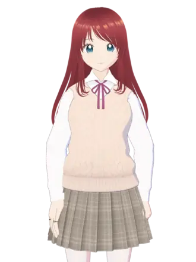
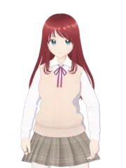
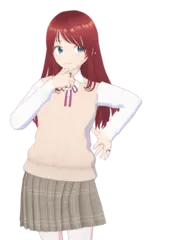
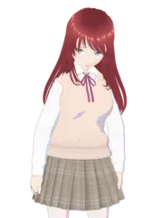
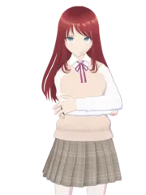
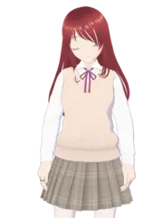
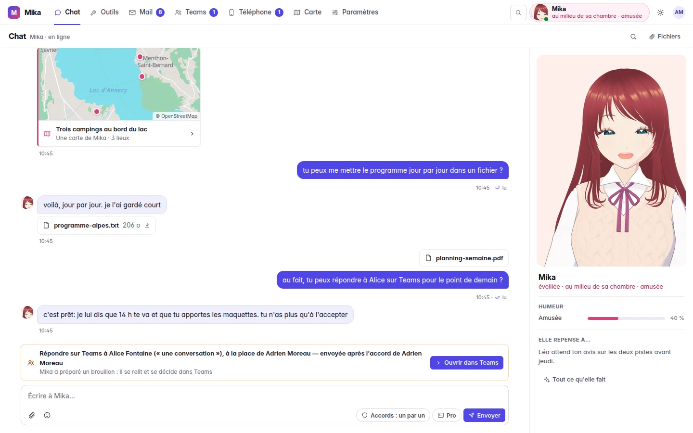
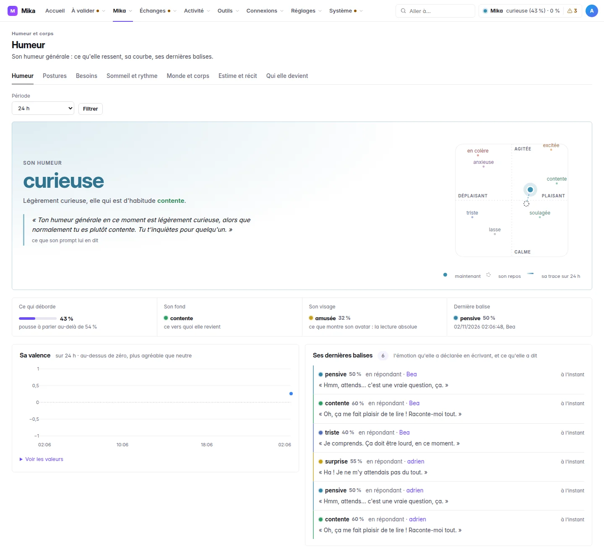
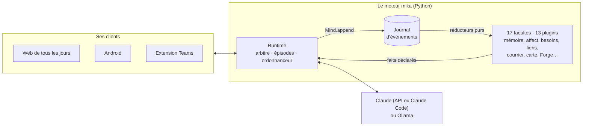

<div align="center">



# Mika

### Une compagne IA qui a sa propre vie

Elle se souvient, ressent, dort et rêve, mène ses projets,<br>
et vient vous parler d'elle-même : sur le web, sur votre téléphone, jusque dans Teams.

<br>

[](#-état-du-projet)
[](LICENSE)
[](https://github.com/ad1rie1/Mika-IA-Companion/commits/main)
[](https://github.com/ad1rie1/Mika-IA-Companion/pulse)
[](https://github.com/ad1rie1/Mika-IA-Companion/issues?q=is%3Aclosed)
[](https://github.com/ad1rie1/Mika-IA-Companion/pulls?q=is%3Aclosed)

[](backend/tests)
[](backend/docs/decisions.md)
[](backend/ARCHITECTURE.md#les-facultés)
[](backend/ARCHITECTURE.md#les-plugins)

[](backend)
[](https://www.anthropic.com/claude)
[](frontend/Web)
[](frontend/Web)
[](frontend/Android)
[](backend/deploy/README.md)

<br>

[Qui est Mika](#-qui-est-mika) · [Ce qu'elle sait faire](#-ce-quelle-sait-faire) · [En images](#-en-images) · [Sous le capot](#-sous-le-capot) · [L'essayer](#-lessayer) · [État du projet](#-état-du-projet) · [Licence](#-licence)

<sub>🇬🇧 An AI companion with a life of her own. The code is in English; the docs, prompts and interface are in French.</sub>

</div>

---

## 💗 Qui est Mika

Mika n'est pas un assistant qui attend qu'on lui parle. Elle a une humeur qui monte et redescend, des besoins, un
sommeil, des souvenirs qui s'usent avec le temps, un lien différent avec chaque personne qu'elle connaît, et des
projets à elle. Quand elle a quelque chose à dire, elle le dit, sans qu'on lui ait rien demandé.

Elle sait aussi donner un coup de main : trier le courrier, préparer une réponse Teams, organiser un voyage, mener un
projet de code du plan jusqu'au livrable. Et rien ne part en votre nom sans votre accord ou une règle que vous avez
posée.

<div align="center">
<table>
  <tr>
    <td align="center"><br><sub>joyeuse</sub></td>
    <td align="center"><br><sub>surprise</sub></td>
    <td align="center"><br><sub>pensive</sub></td>
    <td align="center"><br><sub>triste</sub></td>
    <td align="center"><br><sub>fâchée</sub></td>
    <td align="center"><br><sub>endormie</sub></td>
  </tr>
</table>
</div>

## ✨ Ce qu'elle sait faire

- 💬 **Parler** : dans le chat web, sur Android, dans Teams, par courrier. Une seconde passe réécrit ses messages
  pour qu'ils sonnent comme elle.
- 🧠 **Se souvenir, et oublier** : souvenirs, croyances, promesses, dont la force s'use. Oublier quelqu'un emporte
  vraiment tout ce qui le concerne.
- 💗 **Ressentir** : plusieurs émotions à la fois, lues par le modèle plutôt que devinées par mots-clés, envers chacun,
  et une humeur de fond vers laquelle elle revient.
- 🎛 **Avoir du caractère** : une matrice de personnalité à curseurs et à profils, qui change sa façon de réagir.
- 🌙 **Vivre ses journées** : sommeil, rêves, besoins, attention.
- 📬 **Courrier, Teams, téléphone** : elle lit, trie et prépare des brouillons ; l'envoi suit les règles que vous avez
  posées.
- 🗺 **Carte et voyages** : OpenStreetMap, itinéraires, lieux et avis.
- 🛠 **Travailler** : un mode pro façon Claude Code, des projets qui naissent d'un plan, et la Forge, où elle fabrique
  ses propres petites applis dans un bac à sable.
- 🎨 **Dessiner** : génération d'images en local.
- 🔌 **Outils MCP** : des serveurs externes, avec des droits par personne et par situation.

## 📸 En images

<p align="center">
  <picture>
    <source media="(prefers-color-scheme: dark)" srcset=".github/readme/chat-sombre.webp">
    
  </picture>
  <br>
  <sub><b>Le chat de tous les jours</b> : elle répond, envoie une carte ou un fichier, et prépare une réponse Teams
  qui attend votre accord.</sub>
</p>

<p align="center">
  <picture>
    <source media="(prefers-color-scheme: dark)" srcset=".github/readme/console-humeur-sombre.webp">
    
  </picture>
  <br>
  <sub><b>La console</b> : son humeur du moment, son fond, et chaque émotion qu'elle a déclarée en écrivant.</sub>
</p>

<sub>Les captures montrent des données de démonstration.</sub>

## 🔧 Sous le capot

Mika est une psyché à **journal d'événements**. Tout ce qui lui arrive (un message, une pensée, un rêve) s'ajoute au
journal, et l'état de chacune de ses facultés s'en déduit par des fonctions pures. Sa vie peut donc se rejouer,
s'expliquer et se simuler : une semaine en quelques secondes.



Quelques principes qui tiennent l'ensemble :

- **Les facultés ne se connaissent pas.** Elles ne s'importent jamais entre elles et se lisent par des faits
  déclarés ; `lint-imports` le vérifie à chaque test.
- **Un arbitre décide quand elle parle** : des preuves cumulées en log-odds, et un déclenchement de Poisson qui ne
  dépend pas de la cadence.
- **Ses phrases ne sont pas dans le code.** Sa persona et sa voix vivent dans
  [`persona/`](backend/persona).
- **Pas de repli silencieux.** Un appel au modèle qui échoue est journalisé et remonté, jamais basculé vers un autre
  fournisseur.
- **Mesuré plutôt que deviné** : environ 5 570 tests, des gardes d'architecture, un simulateur, et des bancs où de
  vraies conversations sont jouées puis notées par Opus.
- **Chaque décision est écrite** : 250 décisions argumentées dans
  [`docs/decisions.md`](backend/docs/decisions.md).

Pour tout le détail : [`backend/ARCHITECTURE.md`](backend/ARCHITECTURE.md).

## 🚀 L'essayer

Il faut Python 3.12 ou plus.

```bash
cd backend
python3 -m venv .venv
.venv/bin/pip install -e ".[llm,memory]"
.venv/bin/python -m mika serve
```

Ouvrez <http://127.0.0.1:8001> : la première page crée votre compte, puis **Réglages › Modèles de texte** lui donne
une voix (Claude, Claude Code, Ollama ou un modèle compatible OpenAI).

Son corps en 3D est le modèle libre du dépôt. Pour lui en donner un autre, posez votre VRM dans
`frontend/Assets/models/default.vrm` : il passe devant, et il ne sera jamais versionné.

La suite, pas à pas : [`backend/README.md`](backend/README.md). La mise en service (systemd, MariaDB,
sauvegardes) : [`backend/deploy/README.md`](backend/deploy/README.md).

## 📦 Le dépôt

| Dossier | Ce que c'est |
|---|---|
| [`backend/`](backend) | Le moteur (paquet Python `mika`), sa persona, ses docs et ses bancs de mesure |
| [`frontend/Web/`](frontend/Web) | Le client web de tous les jours : chat, mode pro, courrier, Teams, téléphone, carte |
| [`frontend/Android/`](frontend/Android) | L'app Android, en Kotlin et Compose, avec Mika en 3D native |
| [`frontend/ExtensionChromeTeams/`](frontend/ExtensionChromeTeams) | L'extension Chrome qui la relie à Teams |
| [`frontend/Assets/`](frontend/Assets) | L'art : son modèle, ses mouvements, les scripts Blender de ses portraits |
| [`services/mika-images/`](services/mika-images) | Le serveur d'images local |

## 🚦 État du projet

Un projet personnel, en développement actif.

| Partie | État |
|---|---|
| Le moteur |  |
| Le web de tous les jours |  |
| L'app Android |  |
| L'extension Teams |  |

## 📜 Licence

Le code est **totalement libre**, sous licence [MIT-0](LICENSE). Vous pouvez l'utiliser, le copier, le modifier, le
redistribuer ou le vendre, sans condition, sans même avoir à citer l'auteur.

Ce qui vient d'ailleurs garde sa propre licence :

- le modèle 3D libre de Mika, [`mika-libre.vrm`](frontend/Assets/models/mika-libre.vrm), fait dans VRoid Studio,
  est sous licence publique VRM 1.0 : redistribution et modification permises. Les animations et les captures de
  [`.github/readme/`](.github/readme) le montrent ;
- un modèle acheté peut le remplacer chez soi : il n'entre jamais dans le dépôt ;
- les textures de la pièce, en CC0, venues de Poly Haven ([le détail](frontend/Assets/README.md#licences-des-textures)) ;
- les clips de mocap, tirés de la CMU Graphics Lab Motion Capture Database
  ([les crédits](frontend/Assets/mocap/README.md#provenance-et-licence)) ;
- la police Inter de la console, sous SIL Open Font License 1.1.
